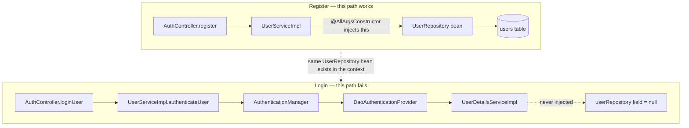
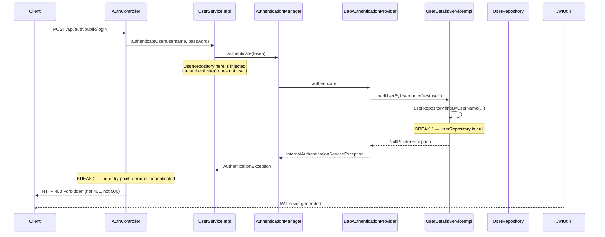
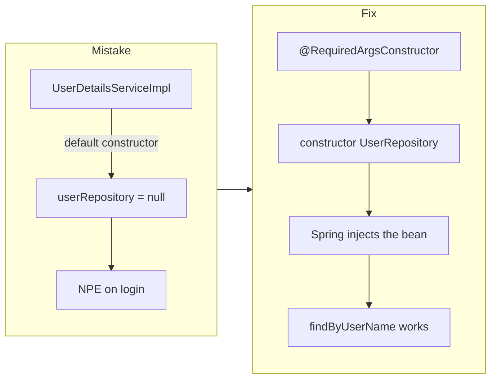
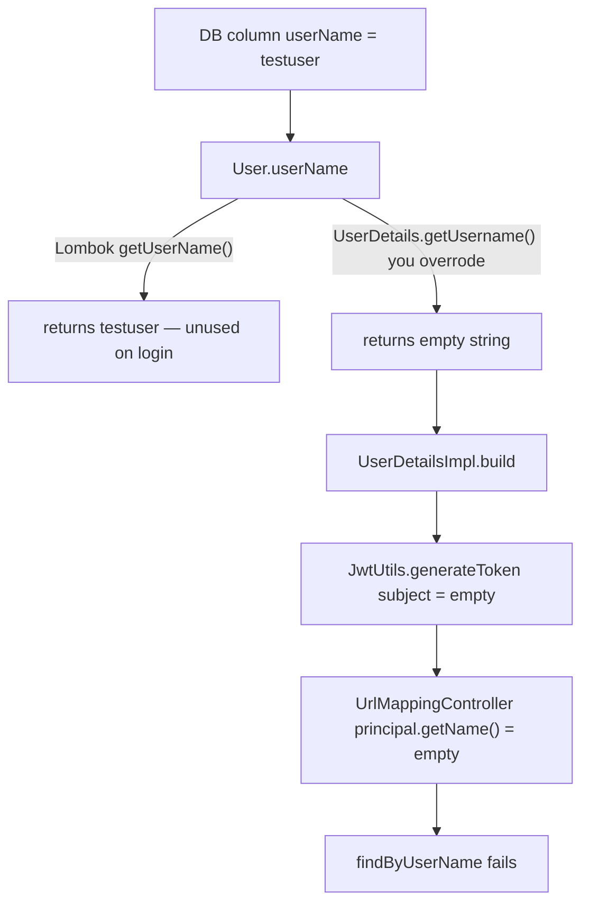
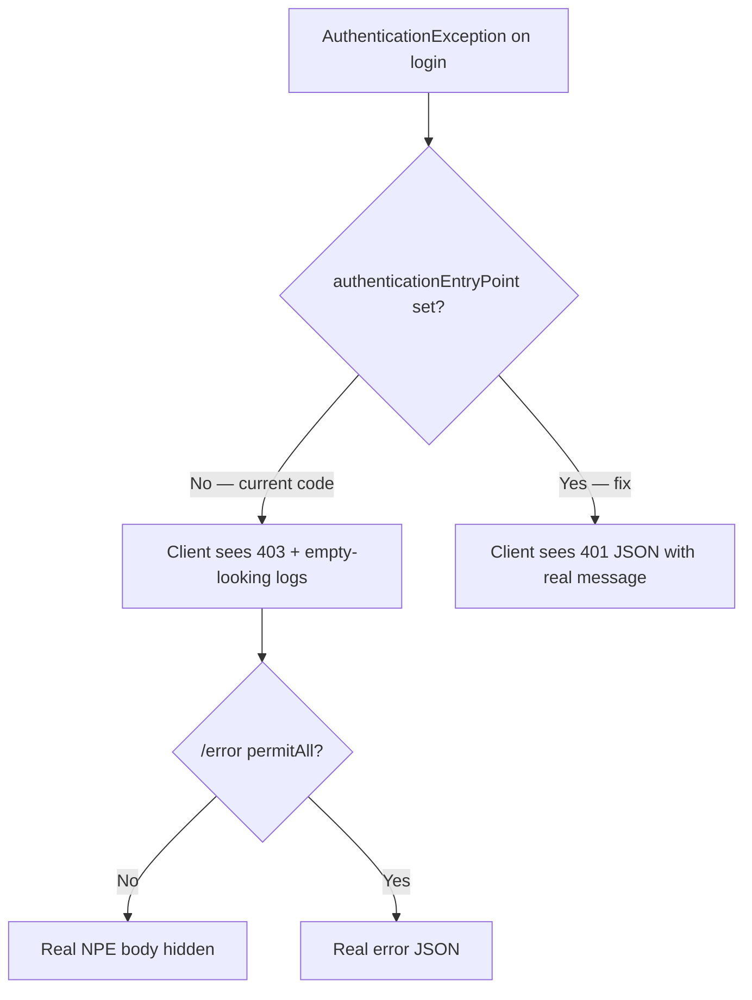
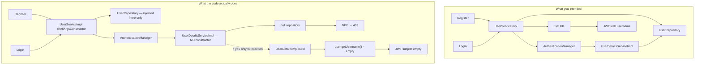
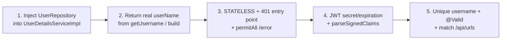
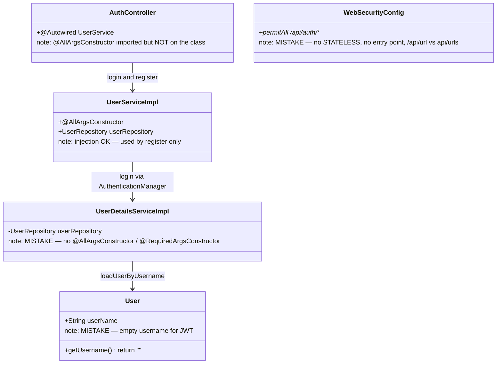

# LinkSnap auth failure map — where it broke and how to fix it

This file is the single diagnosis of **register** and **login**. It is based on the current source and on live HTTP calls against a running app.

**Live results**

| API | Path | Result |
|-----|------|--------|
| Register | `POST /api/auth/public/register` | **200** `User registered successfully` — row saved in Postgres with BCrypt password |
| Login | `POST /api/auth/public/login` | **403 Forbidden** — no JWT, almost no stack trace in logs, `JSESSIONID` cookie set |

Register is not the failure. Login is. After login is repaired, JWT username is still wrong, so protected URL APIs would still fail.

---

## 1. The mistake that is easy to miss

You put `@AllArgsConstructor` on **`UserServiceImpl`**. That **does** inject `UserRepository` into **that** class. That is why register can call `userRepository.save(user)`.

Login **does not** use `UserServiceImpl.userRepository`.

Login uses Spring Security’s `AuthenticationManager`, which calls a **different** bean: `UserDetailsServiceImpl`. That class has **no** constructor injection.



**Rule:** `@AllArgsConstructor` only builds a constructor for **the class you put it on**. Spring injects beans **per class**, not “once for the whole app”.

| Class | `@AllArgsConstructor`? | `UserRepository` injected? | Used by |
|-------|------------------------|----------------------------|---------|
| `UserServiceImpl` | Yes | Yes | register, `findByUserName` |
| `UserDetailsServiceImpl` | **No** | **No — null** | login via `AuthenticationManager` |
| `AuthController` | imported, **not applied** | N/A — uses `@Autowired UserService` | both endpoints |

---

## 2. Full login sequence — exact break point



**Why 403 instead of 500?**

1. NPE is wrapped as `InternalAuthenticationServiceException` (an `AuthenticationException`).
2. `WebSecurityConfig` has no `httpBasic()`, `formLogin()`, or `authenticationEntryPoint`.
3. Spring Security 6 then answers **403 Forbidden**.
4. `/error` is also locked by `.anyRequest().authenticated()`, so the real NPE body is hidden.
5. Default log level does not print that NPE, so the console looks “empty”.

That is why it felt like a security matcher problem even though `/api/auth/**` is `permitAll()`.

---

## 3. Every failure point (ordered)

### Break 1 — login cannot load the user (current 403)

**File:** `src/main/java/com/url/LinkSnap/services/UserDetailsServiceImpl.java`

```java
@Service
public class UserDetailsServiceImpl implements UserDetailsService {
    private UserRepository userRepository; // null at runtime
```

No `@AllArgsConstructor`, no `@RequiredArgsConstructor`, no `@Autowired`, no constructor.

**Fix:**

```java
@Service
@RequiredArgsConstructor
public class UserDetailsServiceImpl implements UserDetailsService {
    private final UserRepository userRepository;

    @Override
    @Transactional
    public UserDetails loadUserByUsername(String username) {
        User user = userRepository.findByUserName(username)
                .orElseThrow(() -> new UsernameNotFoundException("User not found " + username));
        return UserDetailsImpl.build(user);
    }
}
```



---

### Break 2 — even if login succeeded, JWT username is empty

**File:** `src/main/java/com/url/LinkSnap/entities/User.java`

The DB column is `userName`. You also implemented `UserDetails` and overrode:

```java
@Override
public String getUsername() {
    return "";  // always empty
}
```

**File:** `src/main/java/com/url/LinkSnap/services/UserDetailsImpl.java`

```java
user.getUsername()  // this is UserDetails.getUsername() → ""
```

Lombok `@Getter` on field `userName` generates `getUserName()`. That is a **different method** from `getUsername()`.



**Fix (preferred):** do **not** implement `UserDetails` on the JPA entity. Keep `User` as data only. In `UserDetailsImpl.build` use `user.getUserName()`.

**Fix (minimal):**

```java
@Override
public String getUsername() {
    return this.userName;
}
```

Also `getAuthorities()` currently returns `List.of()`. If the entity is ever used as the principal, `@PreAuthorize("hasRole('USER')")` always fails.

---

### Break 3 — 403 masking and sessions

**File:** `src/main/java/com/url/LinkSnap/Security/WebSecurityConfig.java`

Mistakes:

- No `SessionCreationPolicy.STATELESS` — login 403 set `JSESSIONID` (session auth, not JWT).
- No `authenticationEntryPoint` — auth failures become 403.
- `/error` is not `permitAll()`.
- Matcher `/api/url/**` does not match controller `api/urls` (plural, no leading slash).

**Fix shape:**

```java
http.csrf(AbstractHttpConfigurer::disable)
    .sessionManagement(s -> s.sessionCreationPolicy(SessionCreationPolicy.STATELESS))
    .authorizeHttpRequests(auth -> auth
        .requestMatchers("/api/auth/**", "/error").permitAll()
        .requestMatchers("/api/urls/**").authenticated()
        .requestMatchers("/{shortUrl}").permitAll()
        .anyRequest().authenticated()
    )
    .exceptionHandling(e -> e.authenticationEntryPoint(
        (req, res, ex) -> {
            res.setStatus(HttpServletResponse.SC_UNAUTHORIZED);
            res.setContentType("application/json");
            res.getWriter().write("{\"error\":\"Unauthorized\",\"message\":\"" + ex.getMessage() + "\"}");
        }
    ));
```



---

### Break 4 — JWT helpers will fail after login

**File:** `src/main/java/com/url/LinkSnap/Security/jwt/JwtUtils.java`

| Mistake | What happens |
|---------|----------------|
| Property `jwt.secrect` (typo) | Works only because code and env both use the typo (`JWT_SECRECT_KEY`). Standard `jwt.secret` would be empty. |
| `jwt.expiration=${JWT_EXPIRATION_TIME:}` | Empty default. App may fail to start converting `""` to `int` if env is missing. |
| `validateToken` uses `parseClaimsJws` | `getUserNameFromJwtToken` already uses `parseSignedClaims` (JJWT 0.12+). Invalid tokens throw; method never returns `false`. |
| `JwtAuthenticationFilter` `catch (Exception) { printStackTrace(); }` | JWT errors are swallowed; request continues unauthenticated → 403 on protected URLs. |

**Filter mistake:** `WebSecurityConfig` does `return new JwtAuthenticationFilter()` then relies on field `@Autowired`. It works only because the object is a Spring `@Bean`. Prefer constructor injection of `JwtUtils` and `UserDetailsService` and **do not** also add `@NoArgsConstructor` if you want a required constructor.

---

### Break 5 — register is 200 but not production-safe

Register saved users (`testuser`, duplicate `Shivam` rows). Remaining mistakes:

- No unique constraint / `existsByUserName` — duplicates insert as 200.
- `RegisterRequestDto.roles` ignored; controller hardcodes `ROLE_USER`.
- Entity default `roles = "ROLE_ADMIN"` if someone saves without setting roles.
- No `@Valid` on the body.
- 200 instead of 201.

---

### Break 6 — config naming

**File:** `src/main/resources/application.properties`

- `DATABASE_NAME` is used as **Postgres username**, not the database name. DB name is inside `DATABASE_URL` (`link_snap`).
- Without env vars, datasource user/password and JWT values are empty.

---

## 4. Intended vs actual architecture



---

## 5. Fix order (do these in sequence)



1. **Must fix for login 403:** inject `UserRepository` in `UserDetailsServiceImpl`.
2. **Must fix or JWT is useless:** `User.getUsername()` / `UserDetailsImpl.build(..., user.getUserName(), ...)`.
3. **Must fix so errors are visible:** stateless sessions, 401 entry point, `/error` public.
4. **Then JWT:** real property names, `parseSignedClaims`, do not swallow filter exceptions.
5. **Then register quality:** unique username/email, validation, 201, security matcher `api/urls`.

After 1 + 2, this should work:

```http
POST /api/auth/public/login
Content-Type: application/json

{"username":"testuser","password":"pass123"}
```

Expected: `200` and `{"token":"<jwt>"}` with subject `testuser`.

---

## 6. Quick “where did I write the wrong annotation?” map



`@AllArgsConstructor` on `UserServiceImpl` is correct for that class. The login failure is that the **same pattern was not applied** to `UserDetailsServiceImpl`, which is the class Spring Security actually calls.
